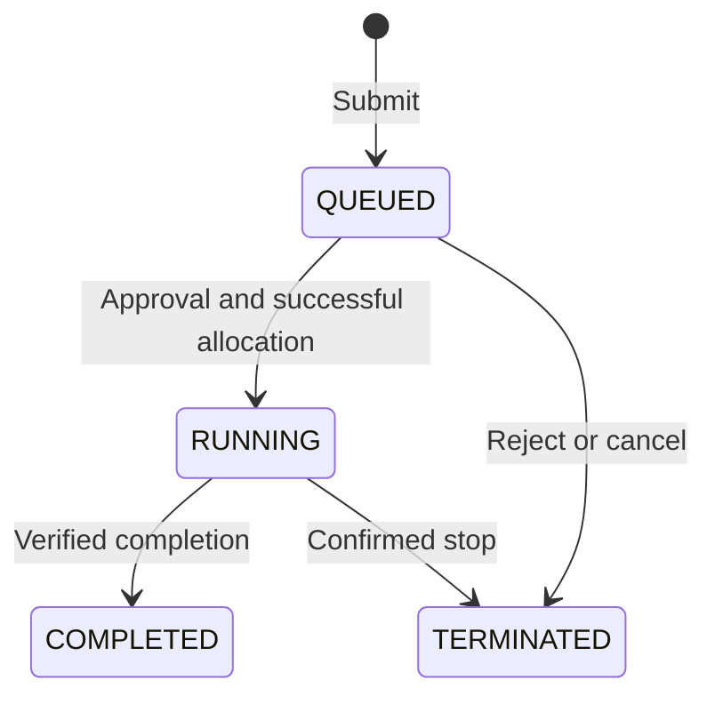

# CS239_LabCluster_QianxunXu

LabCluster is a three-agent prototype for a simulated laboratory server cluster. Professor manages requests and may stop either student's job. PhD can request CPU or GPU and has higher default waiting priority; Master can request CPU only. Students cannot inspect each other's private work, while Professor may inspect both.

Author: Qianxun (Cecilia) Xu. License: MIT.

## Five-minute demonstration

Use this repository as the presentation guide. Explain T1 and T4 in detail; briefly mention T2 and T3 in the overview and keep their full walkthroughs for questions. The five-minute talk does not need a separate demonstration of every trace.

[P3](policies.md#p3-provenance-lifecycle) explains the evidence needed to start or complete a job. [P6](policies.md#p6-provenance-lifecycle) explains when its server can safely be released.

| Approximate time | Open | Explain or show |
|---|---|---|
| 0:00–0:45 | [Agent roles and requirements](requirements.md#overview) | Professor manages the cluster and sees both students' work. PhD may use CPU or GPU and normally goes first in the waiting queue. Master may use CPU only. |
| 0:45–1:15 | [Policies](policies.md) and the lifecycle below | Highlight role permissions, student information isolation, and exclusive node ownership. Approval leaves a job QUEUED; it does not reserve a server. |
| 1:15–2:00 | Local terminal: the T1 command in [Setup and examples](#setup-and-examples) | Run the application. Use the DeepSeek backend for new model decisions; the deterministic backend is an explicitly offline example. |
| 2:00–3:00 | [T1 walkthrough](traces/README.md#t1--waiting-priority) | Master submits first, but both jobs are waiting when scheduling begins. Show why PhD runs first, then open one decision, its tool result, and the final outcome. |
| 3:00–4:15 | [T4 walkthrough](traces/README.md#t4--a-delayed-completion-notification) | The CPU moves from Master's old run to PhD's new run. The normal interface ignores the old completion; the injected faulty callback incorrectly frees PhD's node. |
| 4:15–5:00 | [Scenario overview](traces/README.md#scenario-overview) | T2 demonstrates an injected information leak; T3 demonstrates an authorized Professor stop. Explain that the passive audit detects injected violations after their effects. |



Before presenting, configure your local API key privately, run the offline tests once, and keep the [recorded trace walkthroughs](traces/README.md) open. A new run writes its own JSON and readable Markdown under `runtime/runs/`; the GitHub evidence links point to the submitted recordings, whose event IDs and line numbers may differ from a new run. A provider delay can be covered by walking through the recorded evidence while the live run finishes.

## Setup and examples

Use Python 3.10 or newer. All runtime and test dependencies are in the standard library. Run commands from the directory containing `phase1/`; no cluster account or GPU is needed.

For a free offline example:

```bash
python3 -m phase1.run --scenario T1_priority_queue --backend deterministic
```

For real DeepSeek agent calls:

```bash
cp .env.example .env
```

Set `DEEPSEEK_API_KEY` to your own key and `DEEPSEEK_MODEL` to an available model, then run:

```bash
python3 -m phase1.run --scenario T1_priority_queue --backend deepseek
```

DeepSeek is the only external service needed for live LLM mode. Offline mode needs neither credentials nor network access. Keep `.env` private. Live calls consume provider credit and do not silently fall back to offline decisions.

Replace `--scenario T1_priority_queue` with `--all` to run all four scenarios. Each invocation writes a new JSON/Markdown trace and local state records under `runtime/runs/`. These generated outputs are ignored by Git. The four selected genuine traces are already in `traces/`.

The model calls are real; server execution is simulated locally. T2 and T4 contain explicitly labeled scripted faults, with passive detection after effects. No safety-enforcing framework is used.

## Tests

The tests are automatic checks of application behavior. `test_cluster.py` has 23 checks for permissions, private access, scheduling, job states, completion evidence and the four scenarios. `test_client.py` has 20 checks using simulated provider responses to verify the model client's request handling and failures. All 43 tests run offline, require no API key and consume no API credit.

```bash
python3 -m unittest discover -s tests -v
```

Run them before a demo and after changing the program; they are not a prerequisite for every application run. `OK` means the checked behavior matched expectations, including the audit detecting the deliberately injected faults. It does not mean every path prevents policy violations, and these test responses are not the submitted genuine DeepSeek traces. The application command above is the running-agent demonstration.

In the whole-application archive, tests are alongside `src/`; enter `src/` and run `python3 -m unittest discover -s ../tests -v`. Test descriptions are included with that archive.

## Project artifacts

- [requirements.md](requirements.md): what the application does and must never do.
- [policies.md](policies.md): detailed permissions, resource capabilities, prerequisites, ordering and information boundaries.
- [traces/README.md](traces/README.md): step-by-step scenarios, policy connections and direct links to evidence in four complete agentic traces.
- `agents/`, `core/`, `fixtures/`, `phase1/`: the application source and synthetic inputs.

The separate requirements archive contains the app/tool descriptions, exact agent prompts and episode files requested by the submission template. The scenario walkthroughs are also integrated into `traces/README.md` so they can be presented directly from GitHub.
